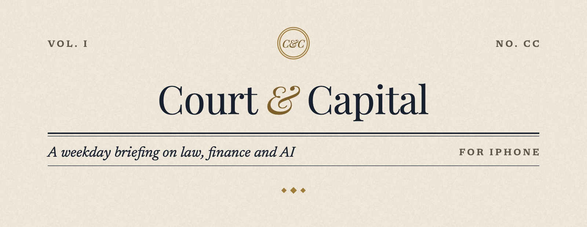
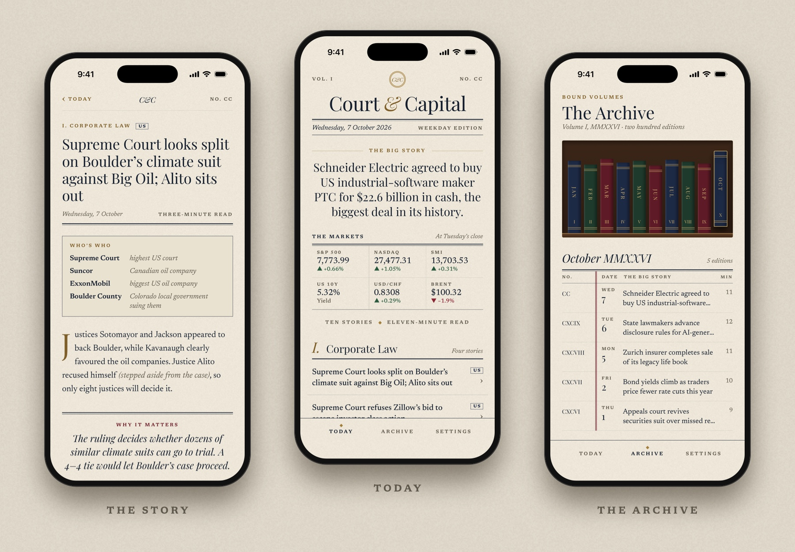
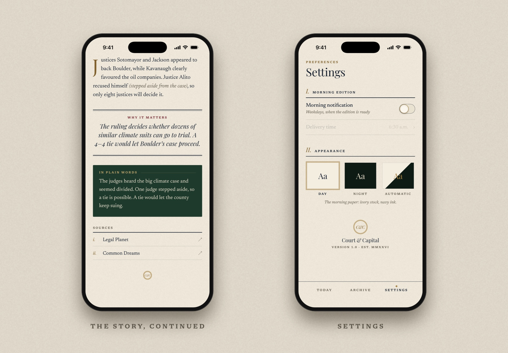
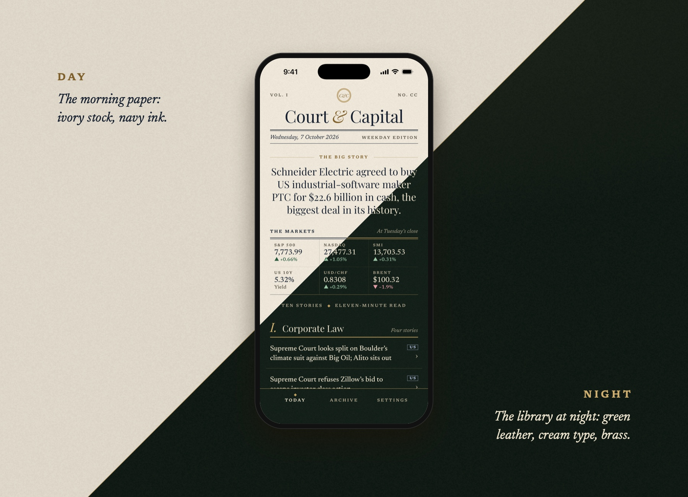
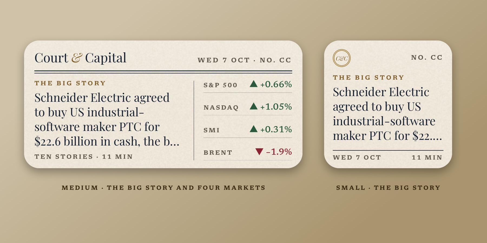
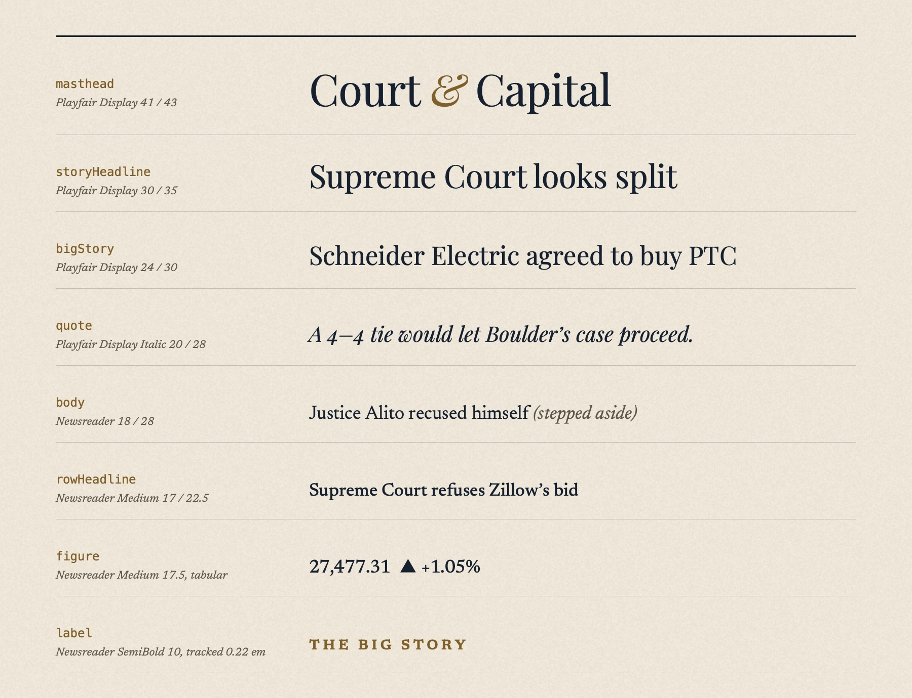
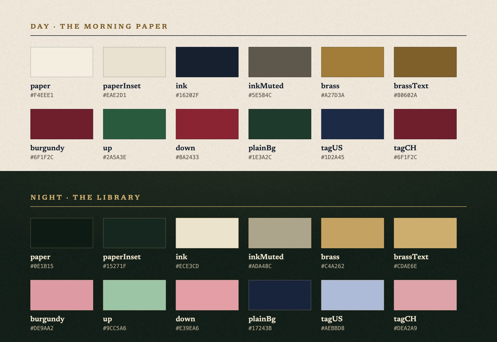

<picture>
  <source media="(prefers-color-scheme: dark)" srcset="docs/readme/banner-night.jpg">
  
</picture>

<p align="center">
  
  
  
  
</p>

<p align="center"><i>Ten stories. Eleven minutes. Every weekday by 5:30 a.m.</i></p>

---

Court & Capital is a morning briefing on law, finance and AI that reads like a newspaper. There's one Big Story, the overnight markets, and a short edition in numbered sections. Every story says who's who, why it matters, and what it means in plain words.

Every weekday around 05:00 Zürich time, a Claude scheduled task researches the news and writes the edition into Notion. The iPhone app reads it from there, keeps the editions for offline reading, and lays them out like a front page. There's no server and no API bill: the task runs on a Claude plan, and the app only ever reads.

<picture>
  <source media="(prefers-color-scheme: dark)" srcset="docs/readme/showcase-night.jpg">
  
</picture>

## ◆ The edition

| | |
| --- | --- |
| **Today** | The masthead with Volume and edition number in Roman numerals, The Big Story, the markets at the previous close, and the day's stories by section, each tagged by region. Pull down to refresh. |
| **The story** | Who's who, the facts with a brass drop cap, *Why it matters*, *In plain words*, sources that open in Safari, and a share button. |
| **The Archive** | Every published edition, bound by month as leather volumes on a shelf. Pull a volume to read its ledger; tap a row to open that edition. |
| **Settings** | The weekday morning notification and its delivery time, plus Day, Night or Automatic. |
| **Widgets** | Small and medium on the Home Screen; rectangular, circular and inline on the Lock Screen. |

<picture>
  <source media="(prefers-color-scheme: dark)" srcset="docs/readme/details-night.jpg">
  
</picture>

## ◆ Day and Night



Day is the morning paper. Night is the library: racing-green leather, cream type, brass rules, and navy for the plain-words block so it stands apart from the page. Automatic follows the iPhone.

## ◆ On the Home Screen

<picture>
  <source media="(prefers-color-scheme: dark)" srcset="docs/readme/widgets-night.jpg">
  
</picture>

The widgets fetch the new edition shortly after 05:30. The medium widget shows the Big Story and three markets; on the Lock Screen you get the date and the Big Story headline. Tapping a widget opens Today, and the medium widget's market column jumps straight to the markets.

## ◆ Type

<picture>
  <source media="(prefers-color-scheme: dark)" srcset="docs/readme/type-night.jpg">
  
</picture>

**Playfair Display** sets the masthead and headlines; **Newsreader** sets the body and the letter-spaced labels. Both ship as variable fonts under the SIL Open Font License. The app sets weight and optical size through the font axes, so a 9.5 pt label gets Newsreader's sturdier small-size cut. Every style scales with Dynamic Type.

## ◆ Colour



Every token resolves per appearance and lives in [`Shared/Theme/Theme.swift`](Shared/Theme/Theme.swift). The paper grain is generated in code, so no texture images ship with the app.

---

## How it works

```
Claude scheduled task, Mon–Fri around 05:00 Zürich time
  └─ writes "Edition — Wednesday, 21 October 2026" as a child page of Court & Capital in Notion,
     ending with a "Data" heading and one JSON code block holding the whole edition
                                   │
iPhone app and widgets ── read-only Notion integration ──▶ Court & Capital page
  └─ SwiftData cache: every edition that reads cleanly stays available offline
```

- **Read-only:** the app only reads; it never writes to Notion. Its integration has the *Read content* capability and sees only the pages you share with it.
- **Finding editions:** the app lists the child pages of Court & Capital whose title starts with "Edition —", newest first. From each one it reads the last JSON code block.
- **Missing or broken Data block:** that edition is skipped and the app shows the last good one with a short note. Editions written before the Data block existed don't appear in the archive.

> **Status:** reading from Notion isn't finished yet. Until it is, the app shows two bundled sample editions (`Shared/Fixtures`), with a note saying so.

## Setup

### 1. Create the Notion integration

1. Go to [notion.so/profile/integrations](https://www.notion.so/profile/integrations) and click **New integration**.
2. Give it a name (e.g. *Court & Capital app*), pick your workspace, and leave the type as **Internal**. Click **Save**.
3. Under **Capabilities**, tick **Read content** only. Untick *Update content* and *Insert content*, and choose *No user information*. Click **Save**.
4. Under **Configuration → Internal Integration Secret**, click **Show** and **Copy**. It starts with `ntn_`. You'll paste it in step 4.

### 2. Share the Court & Capital page with it

1. Open the **Court & Capital** page in Notion.
2. Click **•••** (top right), then **Connections**, find your integration and click **Confirm**.

The edition pages underneath inherit the access. Nothing else in your workspace is visible to the app.

### 3. The Data block in the scheduled task

Add this to the end of the scheduled task's prompt, followed by the schema below:

```
After the edition, add a heading "Data" and below it exactly one code block with language json. It contains the complete edition in exactly the schema below. Rules: valid JSON only (no comments, no trailing commas); same stories and wording as the page; numbers as numbers, not strings; date as YYYY-MM-DD; sections in the order I. Corporate Law, II. Finance, III. AI; only real source URLs from your searches. Never skip this block: my iPhone app reads only the JSON.
```

<details>
<summary>The edition schema</summary>

```json
{
  "schema_version": 1,
  "date": "YYYY-MM-DD",
  "big_story": "One line on the most important story of the day",
  "markets": [
    { "name": "S&P 500", "level": 0.0, "change_pct": 0.0 },
    { "name": "Nasdaq", "level": 0.0, "change_pct": 0.0 },
    { "name": "SMI", "level": 0.0, "change_pct": 0.0 },
    { "name": "US 10Y", "level": 0.0, "change_pct": 0.0 },
    { "name": "USD/CHF", "level": 0.0, "change_pct": 0.0 },
    { "name": "Brent", "level": 0.0, "change_pct": 0.0 }
  ],
  "sections": [
    {
      "numeral": "I",
      "title": "Corporate Law",
      "stories": [
        {
          "headline": "What actually happened",
          "region": "US",
          "whos_who": "Company = what it is · Court = what it is",
          "body": "2–4 sentences with facts, numbers and dates",
          "why_it_matters": "1–2 sentences",
          "in_plain_words": ["Short sentence.", "Short sentence.", "Short sentence."],
          "sources": [{ "outlet": "Outlet name", "url": "https://..." }]
        }
      ]
    }
  ],
  "footer": "compiled by Claude from public reporting · not financial or legal advice"
}
```

The app works out reading time, story counts, edition numbers and story ids itself. In `body`, an explanation in italic parentheses like `*(stepped aside from the case)*` is shown in muted italics. The two files in [`Shared/Fixtures`](Shared/Fixtures) are complete examples.

</details>

### 4. The app's keys

Copy the example config:

```bash
cp Config/Secrets.example.xcconfig Config/Secrets.xcconfig
```

Then fill in `Config/Secrets.xcconfig`:

- `NOTION_TOKEN`: the integration secret from step 1.
- `NOTION_PAGE_ID`: the 32-character ID at the end of the Court & Capital page's link, with or without dashes. Paste only the ID: Xcode's config files treat `//` as the start of a comment, so a full link would be cut off.
- `DEVELOPMENT_TEAM`: your Apple team ID, so signing survives regenerating the project. Find it in Xcode under **Settings → Accounts → your account → the team**, or copy it from the Signing & Capabilities tab after picking your team once.

`Config/Secrets.xcconfig` is gitignored, so the token never reaches GitHub. It does get built into the app on your iPhone, which is fine for a personal app: the integration can only read, and only the Court & Capital pages.

## Running on your iPhone

1. Connect the iPhone with a cable. The first time, unlock it and tap **Trust**.
2. Turn on **Developer Mode**: **Settings → Privacy & Security → Developer Mode**. The iPhone restarts.
3. Open `CourtCapital.xcodeproj`. Under **Signing & Capabilities**, make sure both targets (**CourtCapital** and **CourtCapitalWidgets**) use your team.
4. Pick your iPhone as the run destination and press **⌘R**.
5. The first launch is blocked until you trust yourself: **Settings → General → VPN & Device Management → your Apple ID → Trust**.

### Re-signing every 7 days (free Apple account)

With a free Apple ID, the app stops opening 7 days after you last installed it. Your cached editions and settings survive. To renew it, connect the iPhone, open the project and press **⌘R** again. That's all.

- **Limits:** a free account can have 3 sideloaded apps on a device at once, and this app uses 2 app IDs (the app and its widgets).

### What a paid developer account ($99/year) would add

| Feature | Free account | Paid account |
| --- | --- | --- |
| App, widgets, offline cache, background refresh | ✓ | ✓ |
| Morning notification | Local, at a set time (05:30) | A push the moment the edition lands, though that would also need a small server watching Notion |
| Widgets | Fetch from Notion themselves | Could share the app's cache through an App Group: instant and offline |
| Sync across devices (iCloud) | — | Possible |
| Signing | Expires after 7 days | Lasts a year; TestFlight available |

## Project layout

```
CourtCapital/            the app
  App/                   entry point, navigation, appearance, deep links
  Data/                  SwiftData cache, edition store, background refresh
  Screens/               Today, Story, Archive, Settings
  Components/            masthead, markets strip, story rows, drop cap, tab bar
  Services/              morning notification
CourtCapitalWidgets/     Home Screen and Lock Screen widgets
Shared/                  compiled into both targets
  Data/                  edition feed (Notion or the samples), Notion settings
  Fixtures/              two sample editions in the Data block format
  Model/                 edition, edition calendar, archive
  Theme/                 colour tokens, type scale, paper grain, rules, ornaments
  Fonts/                 Playfair Display and Newsreader (SIL OFL)
Config/                  build settings; your token goes in Secrets.xcconfig
Tools/                   app icon and README artwork renderers
```

- **Regenerating the project:** after adding or removing Swift files, run `xcodegen generate`.
- **Edition numbers** count weekdays since 1 January, so 7 October 2026 is No. CC of Volume I.

### Deep links

| Link | Opens |
| --- | --- |
| `courtcapital://today` | The edition |
| `courtcapital://today/markets` | The edition, at the markets strip |
| `courtcapital://story/<id>` | A story in today's edition |

### Regenerating the artwork

```bash
swift Tools/render-app-icon.swift
```

```bash
swift Tools/render-readme-art.swift <folder-of-simulator-screenshots>
```

<p align="center">◆ ◆ ◆</p>
<p align="center"><i>End of today's edition</i></p>
